**Tech lead by day, indie hustler by night.** A little curious, always building. Based in Antalya.

### ships

| | | |
|---|---|---|
| **CutieCure** | AI nail art studio | [App Store](https://apps.apple.com/us/app/nail-art-design-cutiecure/id6753126162) · [Google Play](https://play.google.com/store/apps/details?id=app.cutiecure) · [cutiecure.app](https://www.cutiecure.app) |
| **CheffEye** | AI recipe assistant | [App Store](https://apps.apple.com/app/cheffeye/id6502579584) · [Google Play](https://play.google.com/store/apps/details?id=com.cheffeye) · [cheffeye.com](https://cheffeye.com/en/) |
| **Pawnce** | Real-world pet collecting | [App Store](https://apps.apple.com/app/pawnce-catch-cats-dogs/id6783541896) · [pawnce.app](https://pawnce.app/) |
| **Pocketframe** | Mac app for the DJI Osmo Pocket | |
| **CutieCure Salon** | Booking and salon management SaaS | [salon.cutiecure.app](https://salon.cutiecure.app) |
| **ViralSlides** | AI marketing engine for app makers | [viralslides.app](https://www.viralslides.app) |

### reach

[kerim@rimabel.com](mailto:kerim@rimabel.com) · [LinkedIn](https://www.linkedin.com/in/kerim-embel/) · [X](https://x.com/kerimmembel)

ships.log is redrawn every morning from the last 12 months of my commits.
