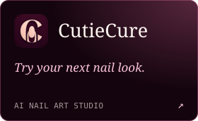
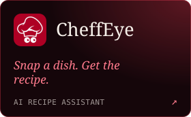
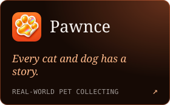
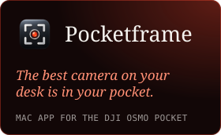
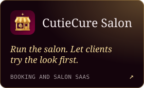
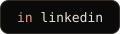
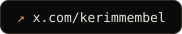

**Tech lead by day, indie hustler by night.** A little curious, always building. Based in Antalya.

### ships

### reach

ships.log is redrawn every morning from the last 12 months of my commits.
